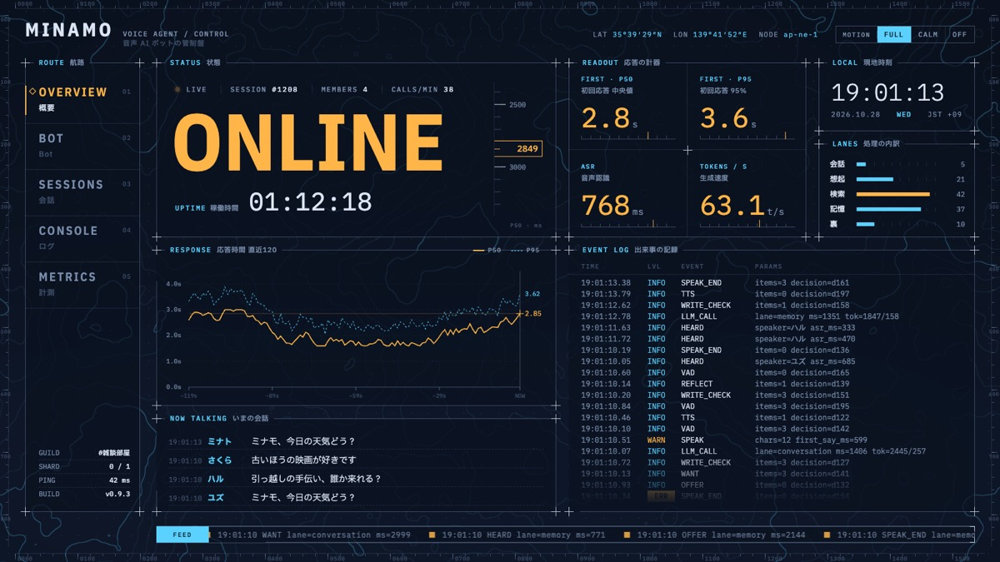
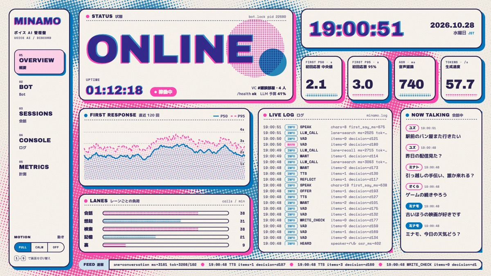
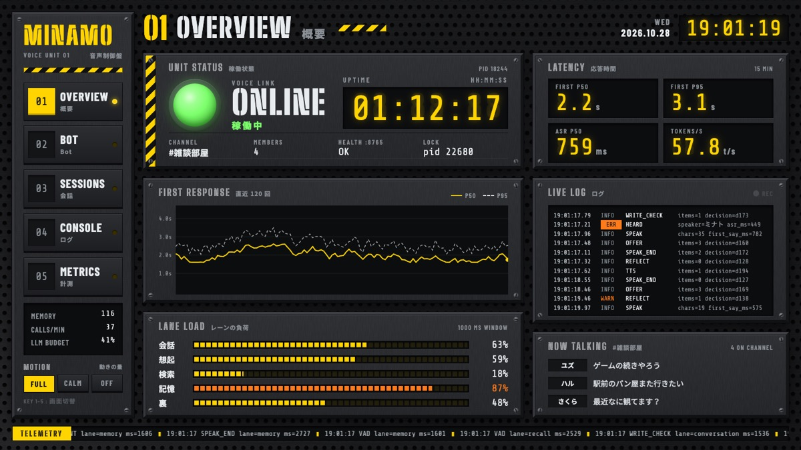
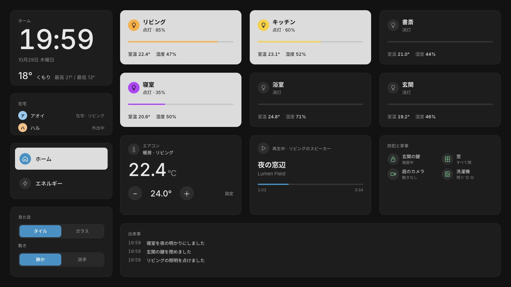
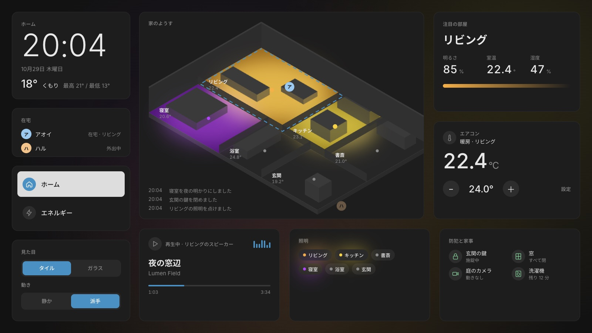
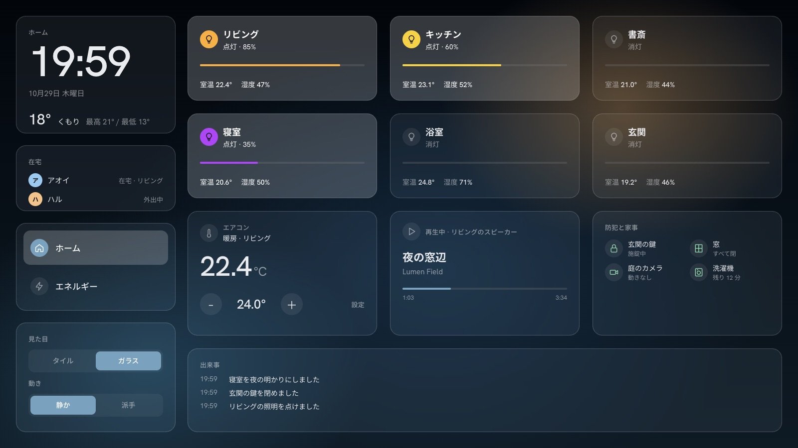
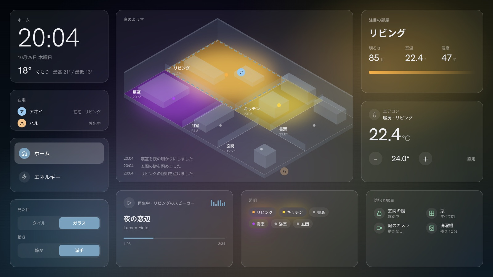
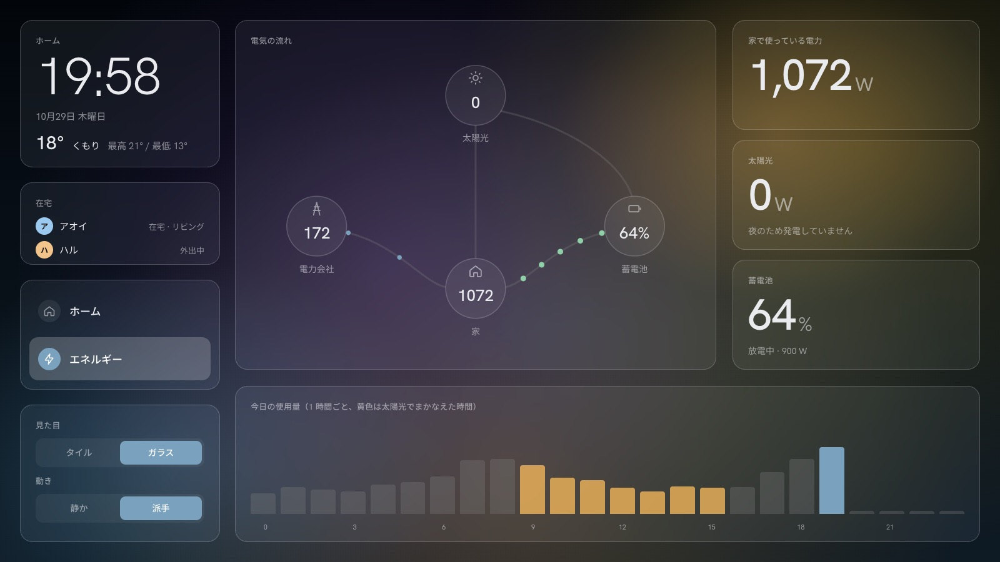

# 見た目の方向

作成: 2026-10-28。3 案を同じ中身（ボットの管理画面の概要ページ）で作り、見た目だけを比べられるようにした。
見本: `open prototype/direction-a.html prototype/direction-b.html prototype/direction-c.html`
どの見本も `?motion=full|calm|off`（動きの量）と `?bg=none`（背景を透明にして OBS に重ねる）を試せる。

## 元作品と避ける点

元にした作品（X の @MatchaChoco010 氏の動画, 2026-10-26）と、それに近づけて作った最初の試作（公開のときに外した）の特徴のうち、次のものを成果物では使わない。

2026-10-31 所有者の判断 A: 避けるのは元の作品の配色と固有の飾りだけにする。傾いた枠・巨大な文字・円に沿って回る文字・切り替えの演出は、誰でも使う技法なので戻す（見た目「ゲーム」、components.md の「ゲームの見た目」）。
それまでは技法ごと禁じていた。そのため最初の試作の面白さが部品集から消え、憲章の目的（傾いたパネル・大きな文字・画面切り替えの演出）と食い違っていた。

| 避ける特徴 | 試作での実装 | 機械での確認 |
|---|---|---|
| 白〜薄いミントの紙＋黒＋赤の 3 色 | `#9fe3c9` `#5fcaa5` `#e8433a` | `tools/check_directions.sh` が色の値を探す |
| 墨が流れる大理石の背景 | WebGL の fbm で描いた墨の筋 | 目視 |
| 縁取りだけの巨大な数字 | `-webkit-text-stroke` | 同上のスクリプトが探す |
| 巨大な縦書きの漢字 | `writing-mode: vertical-rl` | 同上 |
| 筆記体の飾り語（Awake など） | Playfair Display の斜体 | 目視 |
| バーコード、角を切ったパネル | `.barcode`、`.panel` の clip-path | 目視 |
| 元の作品の書体 | Anton、Dela Gothic One | T057 の Gate が `themes/game.css` を探す |

使ってよいもの: 固定 16:9 の舞台を拡大縮小する作り、WebGL の背景、画面切り替えの演出、値が流れ込む部品。2026-10-31 からは、傾いた枠、斜めの見出しの帯、巨大な文字（塗りつぶし）、円に沿って回る文字も使ってよい。

## 案A 夜の地形図

- 見本: [prototype/direction-a.html](../../prototype/direction-a.html)
- 配色: 地 `#0b1220`、主な数値は琥珀色 `#ffb547`、副の値は水色 `#5ad1ff`、罫は 1px の薄い青
- 書体: IBM Plex Mono（数字）、IBM Plex Sans JP、IBM Plex Sans Condensed
- 背景: 流れる等高線と点の格子。舞台の四辺に座標の目盛り
- パネル: 1px の罫の長方形。四隅に十字の印。見出しは罫の上に載せる
- 画面切り替え: 水色の走査線が上から下へ走り、パネルの罫を引き直す
- 合う場面: 壁や机の常時表示、夜の部屋。暗く静かで、長時間見ても疲れにくい
- 弱い点: 暗い地に青と琥珀は SF 風の管理画面でよくある組み合わせで、市場調査の D 群（ThemeForest の HUD 雛形）と見分けにくい

## 案B リソグラフ印刷

- 見本: [prototype/direction-b.html](../../prototype/direction-b.html)
- 配色: 紙 `#f3efe6`、インクは蛍光ピンク `#ff48b0` と青 `#0078bf` の 2 色と、その重なりの紫。文字は濃い青紫 `#2a2350`
- 書体: Archivo Black、M PLUS 1p（800/900）、Space Mono
- 背景: 形を変える大きな塊を 2 色の網点で刷ったもの
- パネル: 角丸の四角、太いインクの縁、ピンクか青のずらした影。棒やグラフの面も網点で塗る
- 画面切り替え: 青の版が滑り込み、ピンクの版が少し揺れて重なる
- 合う場面: 配信の画面、イベント、発表。調べた範囲に同じ見た目の部品集は無く、いちばん覚えてもらいやすい
- 弱い点: 明るい地なので、OBS でゲーム画面に重ねると浮きやすい。夜の常時表示には眩しい。この見た目の需要を示す販売例は見つけていない

## 案C 工場の操作盤

- 見本: [prototype/direction-c.html](../../prototype/direction-c.html)
- 配色: 地 `#1a1b1d`、盤 `#232427`、合図の色は安全黄 `#ffd400`、文字は冷たい白 `#e8ecef`、ONLINE のランプ `#7cff6b`、警告は橙 `#ff7a1a`
- 書体: Big Shoulders Stencil Display（見出し）、Share Tech Mono（数字。消えた桁の 8 を薄く敷いて 7 セグ表示に見せる）、Barlow Condensed、Noto Sans JP
- 背景: 穴あき鋼板がゆっくり流れ、斜めの光の帯がなでる
- パネル: 面取りに見える厚い枠の長方形、四隅のねじ頭、ステンシル体の名札。黄黒の斜線は要所だけ
- 画面切り替え: 鋼のスラットが上から閉じ、黄色い線が光り、下から開く
- 合う場面: 配信（ゲームやレースの画面と相性がよい）、ボットの管理画面、自宅サーバーの画面
- 弱い点: 黄と黒は強いので、長時間の常時表示では落ち着かない人もいる。画面の切り替えの間、全面がシャッターで隠れる時間が長めに感じられる

## 推奨

**2026-10-29 改訂: 案C の推奨は取り下げた。** 前の版は、配信への重ねやすさと競合との違いだけで案C を推していて、見た目そのものの需要を調べていなかった。
需要の調査（[look.md](../research/look.md)）では、案C の系統（重い工業風）は選ばれた数字がほぼ無く、3 案の中で最も弱かった。案B の系統（リソグラフ）も同じく弱い。
3 案の中で需要の数字が最も大きいのは案A の系統（SF の HUD）だが、星の数は興味の数で、既製品とも似ている。

次の手（2026-10-29 改訂）: 方向が Home Assistant 向けに決まった（CHARTER.md）。見た目の候補は、Home Assistant で人気の暗い画面の特徴を調べ、その上位から作り直す。案A〜C は参考として残す。
黄黒の縞は、警告を出すときの飾りとしてだけ残す。

## Home Assistant 向けの試作

作成: 2026-10-29（T027）。候補は [ha-look.md](../research/ha-look.md) の候補1・候補2。画面の中身は家（部屋の照明、室温、電力、防犯、再生中の曲）。派手版では出来事の記録を間取り図の左下に置く。
見本: `open -a "Google Chrome" prototype/ha-home.html`（`open` はファイルの URL から `?` 以降を捨てるので、URL では指定できない。ブラウザの中で URL を書き換えれば効く）。`look=tile|glass`、`variant=quiet|bold`、`screen=energy`、`motion=off`、`bg=none` を試せる。画面の左下でも切り替えられる。

| | 静か（標準） | 派手（所有者の案「需要の高いものを大胆に変えた別版」） |
|---|---|---|
| 候補1 タイル |  |  |
| 候補2 ガラス |  |  |

派手版で変えたところ（どれも静か版には出ない）:

- ホームの中心を、家の間取りの立体図にした。点いている部屋の床が、照明の色と明るさで光る（ha-look.md の候補3「家の絵の灯り」を組み込んだ）。人の位置も図の上に出る
- 背景が、点いている部屋の灯りの色でゆっくり染まる
- 数字が桁ごとに転がって変わる
- 注目の部屋が 7 秒ごとに移り、図の上の点線が流れる
- エネルギーの画面では、電気の流れが電力に比例した粒で動く（）
- 画面を切り替えると、一番明るい部屋の灯りの色が広がって入れ替わる。24 秒ごとに自動で切り替わる

元の作品の特徴（白とミントの紙と黒と赤、墨の背景、縁取りの数字、縦書き、輪に沿った文字、斜めのメニュー）は使っていない（`tools/check_ha_proto.sh` が一部を検査する）。

## 決めたこと

見た目: 利用者が選ぶ（2026-10-30 所有者の判断。「デフォルトはあってもいいが、それはユーザが決めるべき」）
部品集は候補1 タイル（`themes/tile.css`）と候補2 ガラス（`themes/glass.css`）の両方を持ち、使う人が読み込む CSS で選ぶ。派手な動きは `motion="full"` で足す。
何も指定しないときは、タイルの静かな動き（`motion` は `auto` = `calm`）になる。人気の上位 3 件（閲覧の合計 2,971,904）が元で、写真が無くても成り立つため（[ha-look.md](../research/ha-look.md)）。
作る順番は、タイル、ガラスの順。案A〜C は作らない。
2026-10-31: 3 つ目の見た目「ゲーム」（`themes/game.css`）を足した。上の「避ける点」の所有者の判断 A による。

派手版（2026-10-30 追記）: 部品にするとき、派手版を `motion="full"`（動きの量）だけに縮め、間取りの立体図と電気の流れを落としていた。所有者の依頼「派手な Variant」に合わないので戻した。部品は `<cw-floorplan>` と `<cw-flow>`、見本は `demo/home.html` で、画面右上のボタンで派手版に切り替える。見た目（タイル・ガラス）、構成（静か版・派手版）、動きの量（`calm`・`full`・`off`）は、どれも使う人が別々に選べる。
